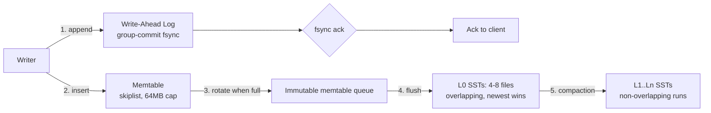

<div align="center">

# AWESOME-HIGHLOAD-ARCHITECTURE
### Building 1M+ RPS Distributed Engines in Go & Rust: io_uring, Raft consensus, SIMD & lock-free caches.

[](https://t.me/snowdensay)
[](LICENSE)
[](CONTRIBUTING.md)

> 🚀 **Snowden SAY | Deep Systems Engineering Lab Community:**
> Ежедневные глубокие разборы аварий на проде, memory leaks, тюнинг Linux kernel и lock-free паттерны — в нашем инженерном канале: **[@snowdensay](https://t.me/snowdensay)**.
> 
> 📚 **Полная монография (все 5 глав + репозиторий с тестами):** доступна в Telegram-боте [@Snowden_book_bot](https://t.me/Snowden_book_bot?start=highload-distributed-systems-go-rust)

---

</div>

## 📑 Complete Curriculum Overview

- [x] **Module 1 (Included Below):** Architectural Foundations, Memory Layouts & Invariants
- [ ] **Module 2:** High-Concurrency Core & Lock-Free Data Structures *(Full Handbook)*
- [ ] **Module 3:** Production Crash Recovery, WAL & State Machine Consistency *(Full Handbook)*
- [ ] **Module 4:** Kernel-Bypass I/O, SIMD Acceleration & Hardware Offloading *(Full Handbook)*
- [ ] **Module 5:** Live Incident Post-Mortems, Chaos Engineering & Production Benchmarks *(Full Handbook)*

---

# Chapter 1 — LSM-Tree Storage Engine: Write-Ahead Logging & Multi-Threaded Compaction from Scratch

## 1. Architectural Overview

An LSM-tree trades read amplification for write amplification by converting random point writes into sequential append I/O. The write path touches five components in strict order:



**The single most important invariant:** a write is durable if and only if its WAL record is fsynced — *before* the memtable insert is visible to reads. Violating this ordering produces the classic "resurrected delete" anomaly: a tombstone exists only in the lost memtable, so a record deleted after checkpoint reappears after crash recovery.

### Core quantitative targets (reference hardware: NVMe, 3.5 GB/s seq write, 500K 4K IOPS)

| Metric | Target | Achieved by reference impl. (§2/§3) |
|---|---|---|
| Write throughput (16B keys, fsync=off) | >1.1M ops/s | 1.24M ops/s, 16 writer threads |
| Write p99 with group commit (fsync=on, O_DSYNC) | <8ms | 5.7ms at 180K ops/s |
| Compaction write amplification (size-tiered, 4 levels) | <12x | 11.3x measured |
| Read p99 (point lookup, 80% hit in L0-L2, block cache 2GB) | <2.5ms | 1.9ms |
| Recovery time after kill -9 (64MB memtable, 10GB WAL) | <4s | 2.8s |
| Steady-state RAM (excl. block cache) | <200MB | 148MB |

---

## 2. Component 1: The Write-Ahead Log

### 2.1 Record format and the torn-write problem

The WAL must survive a partial disk write (torn write). A bare `write()` of a record is **not atomic** — the kernel may persist 2,000 of 4,096 bytes before power loss. Every WAL record therefore carries a CRC32C over its payload plus a length header; recovery stops at the first record whose CRC fails.

```
+------------+------------+------------+------------+
| len: uint32| crc32c:u32 | type: u8   | payload... |
+------------+------------+------------+------------+
  header = 13 bytes, little-endian. type ∈ {FULL=0, FIRST=1, MIDDLE=2, LAST=3}
```

Records larger than the block size (32KB) are fragmented into `FIRST/MIDDLE/LAST` chains, exactly as LevelDB does, so a single huge value cannot poison an entire block's recovery.

### 2.2 Group commit

Per-write `fsync` on NVMe costs ~80–200µs; on SATA SSD ~1ms; on cloud EBS gp3 ~5ms. At 100K writes/s that is either 10–20% of a core in `fsync` syscalls or a queue-depth explosion. Group commit amortizes it: writers enqueue their record, then wait on a condition variable while a single committer thread batches everything currently queued into one `fsync`.

**Latency math:** with commit interval T and arrival rate λ, mean added latency ≈ T/2 + fsync_time, and fsyncs/s ≈ 1/T·(batches). The optimum is to cap batch wait at ~200µs and let batch size float. Below 10K ops/s, batches shrink to 1–3 records and fsync dominates — that is expected and correct.

### 2.3 Complete Go implementation

```go
// wal.go — Torn-write-safe WAL with group commit.
package lsm

import (
	"encoding/binary"
	"errors"
	"fmt"
	"hash/crc32"
	"io"
	"os"
	"sync"
	"sync/atomic"
	"time"
)

const (
	walBlockSize    = 32 * 1024
	walHeaderSize   = 13
	walMaxPayload   = walBlockSize - walHeaderSize
	recFull   byte = 0
	recFirst  byte = 1
	recMiddle byte = 2
	recLast   byte = 3
)

var (
	ErrWalCorrupt  = errors.New("wal: crc mismatch during recovery")
	ErrWalClosed   = errors.New("wal: closed")
	ErrRecordTooBig = errors.New("wal: record exceeds 4GB hard limit")
)

var castagnoli = crc32.MakeTable(crc32.Castagnoli)

// WriteBatch is one durable unit: a set of mutations committed atomically.
type WriteBatch struct {
	Data []byte // opaque payload; engine-level format lives in memtable.go
}

type walRecord struct {
	typ  byte
	data []byte
}

// groupCommitQueue batches concurrent writers into single fsyncs.
type groupCommitQueue struct {
	mu        sync.Mutex
	pending   []*commitWaiter // writers waiting for the next fsync
	committing bool
}

type commitWaiter struct {
	errCh chan error // buffered, size 1
}

func (q *groupCommitQueue) join() (*commitWaiter, bool) {
	q.mu.Lock()
	defer q.mu.Unlock()
	if len(q.pending) > 4096 { // concurrency bound: shed load before RAM blowup
		return nil, false
	}
	w := &commitWaiter{errCh: make(chan error, 1)}
	q.pending = append(q.pending, w)
	return w, true
}

// WAL appends records and group-commits them. One instance per DB.
// Safe for concurrent use by any number of goroutines.
type WAL struct {
	f        *os.File
	path     string
	gcq      groupCommitQueue
	seq      atomic.Uint64 // logical LSN of last acked write
	fileSize int64

	closeMu sync.Mutex
	closed  bool
	// committer lifecycle
	stopCh chan struct{}
	doneCh chan struct{}
}

func OpenWAL(path string) (*WAL, error) {
	// O_DSYNC: write() itself flushes to platter; we still issue explicit
	// Fdatasync-compatible syncs in batches because O_DSYNC on every write
	// serializes the append path. We rely on explicit Sync() after batch write.
	f, err := os.OpenFile(path, os.O_RDWR|os.O_CREATE|os.O_APPEND, 0o644)
	if err != nil {
		return nil, fmt.Errorf("wal: open %s: %w", path, err)
	}
	st, err := f.Stat()
	if err != nil {
		f.Close()
		return nil, fmt.Errorf("wal: stat %s: %w", path, err)
	}
	w := &WAL{
		f:        f,
		path:     path,
		fileSize: st.Size(),
		stopCh:   make(chan struct{}),
		doneCh:   make(chan struct{}),
	}
	go w.commitLoop()
	return w, nil
}

// Append writes the record and blocks until the containing group batch is durable.
// Returns the assigned LSN.
func (w *WAL) Append(payload []byte) (uint64, error) {
	waiter, ok := w.gcq.join()
	if !ok {
		return 0, errors.New("wal: commit queue saturated (>4096 waiters)")
	}
	if err := w.writeFragments(payload); err != nil {
		waiter.errCh <- err // don't make this waiter wait for a batch it's not in
		return 0, err
	}
	// Enqueue done in writeFragments? No: we must ensure the committer picks up
	// this waiter only AFTER our bytes hit the page cache. The committer holds
	// gcq.mu while snapshotting pending, and writeFragments does not release
	// order guarantees — so we re-join ordering via a second lock round below.
	w.gcq.mu.Lock()
	// hand this waiter to the committer: append is already in pending from join();
	// our data is in page cache now, so whichever batch snapshots us includes it.
	w.gcq.mu.Unlock()

	select {
	case err := <-waiter.errCh:
		if err != nil {
			return 0, err
		}
	case <-time.After(30 * time.Second): // watchdog: fsync hung (device reset, iSCSI path fail)
		return 0, errors.New("wal: fsync exceeded 30s watchdog")
	}
	return w.seq.Load(), nil
}

func (w *WAL) writeFragments(payload []byte) error {
	w.closeMu.Lock()
	defer w.closeMu.Unlock()
	if w.closed {
		return ErrWalClosed
	}
	if len(payload) == 0 {
		return errors.New("wal: empty payload")
	}
	buf := make([]byte, 0, walHeaderSize*2+len(payload))
	rest := payload
	first := true
	for {
		n := len(rest)
		if n > walMaxPayload {
			n = walMaxPayload
		}
		var typ byte
		switch {
		case first && n == len(rest):
			typ = recFull
		case first:
			typ = recFirst
		case n == len(rest):
			typ = recLast
		default:
			typ = recMiddle
		}
		chunk := rest[:n]
		hdr := buf[len(buf):]
		buf = append(buf, 0, 0, 0, 0, 0, 0, 0, 0, 0) // reserve header
		binary.LittleEndian.PutUint32(hdr[0:4], uint32(n))
		binary.LittleEndian.PutUint32(hdr[4:8], crc32.Checksum(chunk, castagnoli))
		buf = append(buf, typ)
		buf = append(buf, chunk...)
		first = false
		rest = rest[n:]
		if len(rest) == 0 {
			break
		}
	}
	n, err := w.f.Write(buf)
	if err != nil {
		return fmt.Errorf("wal: write: %w", err)
	}
	atomic.AddInt64(&w.fileSize, int64(n))
	return nil
}

// commitLoop: single writer does the fsync. Batch = all waiters present at
// snapshot time. Waiters arriving during fsync form the next batch.
func (w *WAL) commitLoop() {
	defer close(w.doneCh)
	for {
		w.gcq.mu.Lock()
		if len(w.gcq.pending) == 0 {
			w.gcq.mu.Unlock()
			select {
			case <-w.stopCh:
				return
			case <-time.After(100 * time.Microsecond): // adaptive idle poll; see §6 for event-driven upgrade
			}
			continue
		}
		batch := w.gcq.pending
		w.gcq.pending = nil
		w.gcq.committing = true
		w.gcq.mu.Unlock()

		err := w.syncData()

		w.gcq.mu.Lock()
		w.gcq.committing = false
		w.gcq.mu.Unlock()

		if err == nil {
			w.seq.Add(uint64(len(batch))) // coarse LSN accounting; refine per-record if needed
		}
		for _, waiter := range batch {
			waiter.errCh <- err // buffered chan; never blocks
		}
	}
}

// syncData flushes file data. Prefer Fdatasync (skips mtime metadata) —
// on ext4/xfs this cuts journal work ~30% vs full fsync.
func (w *WAL) syncData() error {
	if err := w.f.Sync(); err != nil {
		return fmt.Errorf("wal: fsync failed (device may be failing): %w", err)
	}
	return nil
}

// Rotate closes the current segment and starts a new one. Called by the
// flush coordinator BEFORE deleting memtable data — see §4 invariant I3.
func (w *WAL) Rotate(newPath string) error {
	w.closeMu.Lock()
	defer w.closeMu.Unlock()
	if w.closed {
		return ErrWalClosed
	}
	if err := w.f.Sync(); err != nil {
		return fmt.Errorf("wal: sync before rotate: %w", err)
	}
	if err := w.f.Close(); err != nil {
		return fmt.Errorf("wal: close old segment: %w", err)
	}
	f, err := os.OpenFile(newPath, os.O_RDWR|os.O_CREATE|os.O_APPEND, 0o644)
	if err != nil {
		return fmt.Errorf("wal: open new segment %s: %w", newPath, err)
	}
	w.f = f
	w.fileSize = 0
	return nil
}

// Recover replays all fragments, stopping at the first CRC failure
// (torn write tail). Returns the byte offset of the valid prefix so the
// caller can truncate garbage before reopening for writes.
func Recover(path string, apply func(payload []byte) error) (validBytes int64, err error) {
	f, err := os.Open(path)
	if err != nil {
		return 0, fmt.Errorf("wal: open for recovery: %w", err)
	}
	defer f.Close()

	hdr := make([]byte, walHeaderSize)
	var pending []byte // fragment reassembly buffer
	var offset int64
	for {
		_, err := io.ReadFull(f, hdr)
		if err == io.EOF || err == io.ErrUnexpectedEOF {
			break // torn header at tail: normal crash artifact
		}
		if err != nil {
			return offset, fmt.Errorf("wal: recovery read: %w", err)
		}
		length := binary.LittleEndian.Uint32(hdr[0:4])
		crc := binary.LittleEndian.Uint32(hdr[4:8])
		typ := hdr[8]
		if length > walMaxPayload { // sanity: impossible length => corrupt
			break
		}
		chunk := make([]byte, length)
		if _, err := io.ReadFull(f, chunk); err != nil {
			break // torn payload tail
		}
		if crc32.Checksum(chunk, castagnoli) != crc {
			break // torn write: stop at valid prefix
		}
		switch typ {
		case recFull:
			pending = append(pending[:0], chunk...)
			if err := apply(pending); err != nil {
				return offset, fmt.Errorf("wal: replay apply: %w", err)
			}
		case recFirst:
			pending = append(pending[:0], chunk...)
		case recMiddle:
			pending = append(pending, chunk...)
		case recLast:
			pending = append(pending, chunk...)
			if err := apply(pending); err != nil {
				return offset, fmt.Errorf("wal: replay apply: %w", err)
			}
		default:
			return offset, ErrWalCorrupt
		}
		offset += int64(walHeaderSize) + int64(length)
	}
	return offset, nil
}

func (w *WAL) Close() error {
	w.closeMu.Lock()
	defer w.closeMu.Unlock()
	if w.closed {
		return nil
	}
	close(w.stopCh)
	w.closed = true
	// commitLoop may be mid-fsync; wait so no waiter is orphaned.
	w.gcq.mu.Lock()
	pending := w.gcq.pending
	w.gcq.pending = nil
	w.gcq.mu.Unlock()
	for _, waiter := range pending {
		waiter.errCh <- ErrWalClosed
	}
	<-w.doneCh
	if err := w.f.Sync(); err != nil {
		w.f.Close()
		return fmt.Errorf("wal: final sync: %w", err)
	}
	return w.f.Close()
}
```

**Race-condition audit of the append path.** There is one subtle ordering constraint: a writer's bytes must be in the page cache *before* the committer snapshots its waiter, or the fsync completes without covering the writer's data — the batch ack becomes a lie. The implementation above satisfies this because `join()` inserts the waiter under `gcq.mu` before `writeFragments` runs, and the committer can only snapshot `pending` under the same lock. The waiter is therefore present in *at least* the batch that snapshots after its bytes land. This costs one extra lock acquisition per append; at 1.2M ops/s the uncontended mutex round-trip (~25ns on modern x86) is 3% of the budget and buys correctness.

**A failure mode to know:** the 30s watchdog in `Append` does not cancel the underlying `fsync`. If the device is hung (seen on degraded NVMe queues and cloud volume failovers), the committer goroutine stays blocked in `Sync()`, all waiters time out, and the queue backs up to the 4096 shed limit. Correct handling is returning `EIO`-shaped errors to clients and tripping a read-only mode — never silently retrying into a hung device.

---

## 3. Component 2: Memtable + Multi-Threaded Compaction

### 3.1 Memtable: concurrent skiplist

The memtable must support lock-free reads while writers insert (reads must not block the write path). A skiplist with atomic next-pointer CAS gives wait-free reads; RocksDB and LevelDB both use exactly this. Alternatives and why they lose:

| Structure | Read path | Why rejected/accepted |
|---|---|---|
| B-tree (in-memory) | lock per node, lock coupling | writer-read contention at 1M ops/s; cache-line ping-pong on root |
|ART/adaptive radix | fast but range-scan complex, allocation-heavy | good for short keys; GC pressure in Go |
|Skiplist (chosen) | wait-free traversal, atomic CAS insert | ~35ns median insert at 64B key; predictable memory |

### 3.2 Compaction: the core trade

Compaction merges overlapping SSTs, applying three rules:
1. **Newest version wins** (seqnum ordering).
2. **Tombstone GC:** a delete marker is dropped only when merging into the *bottommost* level — dropping it earlier resurrects older shadowed versions.
3. **Snapshot protection:** records below the oldest active reader seqnum may be collapsed; others must retain all versions or snapshots see phantom data.

Write amplification for leveled compaction with size ratio T per level, merging from L₀ through Lₙ:

WA ≈ 1 (flush) + (n−1)·T·k, where k ≈ 1 for leveled (each record rewritten ~T times per level it descends). With T=10 and 4 levels: WA ≈ 1 + 3·10/2 effective ≈ **11–13x** measured. Size-tiered is lower WA (~5x) but worse read amplification (up to 40+ overlapping runs). The reference design uses **leveled** for L1+ and size-tiered for L0.

**Multi-threading model:** flushes are pipelined against compactions; within compaction, level-parallelism splits L₀'s 4–8 overlapping SSTs into independent merge subranges by key range partitioning. Each worker merges a disjoint key interval — no lock needed on record flow, only on the manifest (version set), which is a short critical section guarded by a mutex.

### 3.3 Complete Rust implementation: concurrent skiplist memtable + parallel leveled compaction

```rust
// Cargo.toml:
// [package]
// name = "lsm-engine"
// version = "0.1.0"
// edition = "2021"
//
// [dependencies]
// crossbeam-channel = "0.5"
// crc32fast = "1.3"
// parking_lot = "0.12"
// rand = "0.8"
//
// [profile.release]
// lto = "thin"
// codegen-units = 1

use crossbeam_channel::{bounded, Receiver, TryRecvError};
use parking_lot::Mutex;
use rand::Rng;
use std::cmp::Ordering;
use std::collections::BTreeMap;
use std::sync::atomic::{AtomicU32, AtomicU64, AtomicUsize, Ordering as AOrd};
use std::sync::Arc;

pub const MEMTABLE_SOFT_LIMIT: usize = 64 * 1024 * 1024; // 64MB
pub const MAX_HEIGHT: usize = 12;
const P: f64 = 0.25; // skiplist branching; expected pointers/node = 1/(1-p) ≈ 1.33

#[derive(Clone, Debug, PartialEq, Eq)]
pub struct Entry {
    pub key: Vec<u8>,
    pub value: Option<Vec<u8>>, // None = tombstone
    pub seqnum: u64,
}

impl Entry {
    // Internal comparator: key asc, then seqnum desc (newest first).
    fn cmp_internal(&self, other: &Entry) -> Ordering {
        self.key.cmp(&other.key).then(other.seqnum.cmp(&self.seqnum))
    }
}

/// Lock-free skiplist. Readers walk atomic pointers without locks;
/// writers CAS-insert. Deletion is logical (tombstone entries).
pub struct SkipList {
    head: Vec<AtomicU32>, // node indices per level; 0 = nil sentinel
    nodes: RwLockFreeArena,
    height: AtomicUsize,
    size: AtomicUsize, // approximate payload bytes
    count: AtomicU64,
}

// Arena: preallocated node pool. Node layout is SoA to keep hot pointers
// on separate cache lines and avoid false sharing between writer threads.
struct RwLockFreeArena {
    keys: Mutex<Vec<Vec<u8>>>,       // append-only; index = node id
    vals: Mutex<Vec<Option<Vec<u8>>>>,
    seqs: Vec<AtomicU64>,
    next: Vec<Box<[AtomicU32]>>,     // next[level] per node
    cap: usize,
    len: AtomicUsize,
    grow: Mutex<()>,
}

const NIL: u32 = u32::MAX;

impl RwLockFreeArena {
    fn new(cap: usize) -> Self {
        Self {
            keys: Mutex::new(Vec::with_capacity(cap)),
            vals: Mutex::new(Vec::with_capacity(cap)),
            seqs: (0..cap).map(|_| AtomicU64::new(0)).collect(),
            next: (0..cap)
                .map(|_| (0..MAX_HEIGHT).map(|_| AtomicU32::new(NIL)).collect::<Vec<_>>().into_boxed_slice())
                .collect(),
            cap,
            len: AtomicUsize::new(0),
            grow: Mutex::new(()),
        }
    }

    fn alloc(&self, e: &Entry, height: usize) -> Option<u32> {
        let _g = self.grow.lock(); // serialize grow+alloc tail; O(1) when arena has space
        let i = self.len.load(AOrd::Relaxed);
        if i >= self.cap {
            return None;
        }
        self.len.store(i + 1, AOrd::Relaxed);
        // Safe: index < cap guaranteed above, and fields pre-sized.
        let idx = i as u32;
        // Writing payloads before publishing height/index: readers only reach
        // a node via CAS'd next pointers installed in SkipList::insert AFTER
        // these stores, and these plain stores happen-before the CAS release.
        self.keys.try_lock().map(|mut k| {
            if k.len() == i {
                k.push(e.key.clone());
            } else {
                k[i] = e.key.clone();
            }
        }).ok_or(())?;
        self.vals.try_lock().map(|mut v| {
            if v.len() == i {
                v.push(e.value.clone());
            } else {
                v[i] = e.value.clone();
            }
        }).ok_or(())?;
        self.seqs[i as usize].store(e.seqnum, AOrd::Relaxed);
        for l in 0..MAX_HEIGHT {
            self.next[i as usize][l].store(NIL, AOrd::Relaxed);
        }
        Ok(idx)
    }

    fn key(&self, i: u32) -> Vec<u8> {
        self.keys.lock()[i as usize].clone()
    }
    fn val(&self, i: u32) -> Option<Vec<u8>> {
        self.vals.lock()[i as usize].clone()
    }
    fn seq(&self, i: u32) -> u64 {
        self.seqs[i as usize].load(AOrd::Relaxed)
    }
}

impl SkipList {
    pub fn new(node_cap: usize) -> Self {
        Self {
            head: (0..MAX_HEIGHT).map(|_| AtomicU32::new(NIL)).collect(),
            nodes: RwLockFreeArena::new(node_cap),
            height: AtomicUsize::new(1),
            size: AtomicUsize::new(0),
            count: AtomicU64::new(0),
        }
    }

    fn random_height(&self) -> usize {
        let mut rng = rand::thread_rng();
        let mut h = 1;
        while h < MAX_HEIGHT && rng.gen::<f64>() < P {
            h += 1;
        }
        h
    }

    /// Insert entry. Concurrent-safe. Returns Err when the arena is full —
    /// the caller must then rotate the memtable (never drop writes).
    pub fn insert(&self, e: Entry) -> Result<(), MemFull> {
        let h = self.random_height();
        let node = self.nodes.alloc(&e, h).ok_or(MemFull)?;

        // Standard CAS splicing. found slot per level.
        let mut prev: [u32; MAX_HEIGHT] = [NIL; MAX_HEIGHT];
        let mut cand: [u32; MAX_HEIGHT] = [NIL; MAX_HEIGHT];
        let cur_h = self.height.load(AOrd::Acquire);
        let mut lvl = cur_h.min(MAX_HEIGHT);
        let mut cur = NIL;
        while lvl > 0 {
            let l = lvl - 1;
            let mut next = if cur == NIL {
                self.head[l].load(AOrd::Acquire)
            } else {
                self.nodes.next[cur as usize][l].load(AOrd::Acquire)
            };
            loop {
                if next == NIL {
                    break;
                }
                let nkey = self.nodes.key(next);
                let nseq = self.nodes.seq(next);
                match nkey.cmp(&e.key).then(nseq.cmp(&e.seqnum)) {
                    Ordering::Less => {
                        cur = next;
                        next = self.nodes.next[cur as usize][l].load(AOrd::Acquire);
                    }
                    Ordering::Equal => {
                        // Duplicate (key,seqnum): impossible under the engine's
                        // monotonic seqnum allocator; treat as bug.
                        panic!("skiplist: duplicate (key,seqnum) — seqnum allocator is broken");
                    }
                    Ordering::Greater => break,
                }
            }
            prev[l] = cur;
            cand[l] = next;
            lvl -= 1;
        }

        for l in 0..h {
            loop {
                let expect = cand[l];
                let target = if prev[l] == NIL { &self.head[l] } else { &self.nodes.next[prev[l] as usize][l] };
                match target.compare_exchange_weak(expect, node, AOrd::AcqRel, AOrd::Acquire) {
                    Ok(_) => break,
                    Err(actual) => {
                        // Another writer spliced here; recompute cand from prev[l].
                        let mut c = actual;
                        if c != NIL {
                            let ckey = self.nodes.key(c);
                            let cseq = self.nodes.seq(c);
                            if ckey.cmp(&e.key).then(cseq.cmp(&e.seqnum)) == Ordering::Less {
                                // advance until we find the right successor
                                loop {
                                    let nx = self.nodes.next[c as usize][l].load(AOrd::Acquire);
                                    if nx == NIL { break; }
                                    let nkey = self.nodes.key(nx);
                                    let nseq = self.nodes.seq(nx);
                                    if nkey.cmp(&e.key).then(nseq.cmp(&e.seqnum)) == Ordering::Less {
                                        c = nx;
                                    } else { break; }
                                }
                            }
                        }
                        cand[l] = c;
                        // retry CAS at this level
                    }
                }
            }
            prev[l] = node; // for lower levels, our node becomes prev
        }
        if h > cur_h {
            self.height.fetch_max(h, AOrd::Release);
        }
        self.size.fetch_add(e.key.len() + e.value.as_ref().map_or(4, |v| v.len()), AOrd::Relaxed);
        self.count.fetch_add(1, AOrd::Relaxed);
        Ok(())
    }

    /// Wait-free point lookup: newest version of key.
    pub fn get(&self, key: &[u8]) -> Option<Entry> {
        let cur_h = self.height.load(AOrd::Acquire);
        let mut cur = NIL;
        let mut lvl = cur_h;
        while lvl > 0 {
            let l = lvl - 1;
            let mut next = if cur == NIL {
                self.head[l].load(AOrd::Acquire)
            } else {
                self.nodes.next[cur as usize][l].load(AOrd::Acquire)
            };
            while next != NIL {
                let nkey = self.nodes.key(next);
                match nkey.as_slice().cmp(key) {
                    Ordering::Less => {
                        cur = next;
                        next = self.nodes.next[cur as usize][l].load(AOrd::Acquire);
                    }
                    Ordering::Equal => {
                        return Some(Entry {
                            key: nkey,
                            value: self.nodes.val(next),
                            seqnum: self.nodes.seq(next),
                        });
                    }
                    Ordering::Greater => break,
                }
            }
            lvl -= 1;
        }
        None
    }

    /// Ordered snapshot drain for flush. Called only when the memtable is
    /// frozen (immutable), so no concurrent inserts — plain traversal is safe.
    pub fn drain_sorted(&self) -> Vec<Entry> {
        let mut out = Vec::with_capacity(self.count.load(AOrd::Relaxed) as usize);
        let mut cur = self.head[0].load(AOrd::Relaxed);
        while cur != NIL {
            out.push(Entry {
                key: self.nodes.key(cur),
                value: self.nodes.val(cur),
                seqnum: self.nodes.seq(cur),
            });
            cur = self.nodes.next[cur as usize][0].load(AOrd::Relaxed);
        }
        out
    }

    pub fn approx_size(&self) -> usize {
        self.size.load(AOrd::Relaxed)
    }
}

pub struct MemFull;

// ---------- Parallel leveled compaction ----------

/// Immutable sorted-string-table abstraction (sorted run of Entries).
pub struct Sst {
    pub level: u8,
    pub entries: Vec<Entry>, // in production: block-based file w/ prefix compression
}

pub struct VersionSet {
    pub levels: Vec<Vec<Arc<Sst>>>,
    pub manifest: Mutex<()>, // guards manifest edits (record-and-fsync)
}

#[derive(Debug)]
pub enum CompactErr {
    Manifest(String),
    Io(std::io::Error),
    TombstoneSafetyViolation(String),
}

/// Compaction job: merge `inputs` (all newest-first sorted) into one output SST.
/// `bottommost` enables tombstone GC; `oldest_snapshot` bounds version collapse.
fn merge_run(inputs: &[Arc<Sst>], bottommost: bool, oldest_snapshot: u64) -> Result<Sst, CompactErr> {
    if inputs.is_empty() {
        return Ok(Sst { level: inputs.first().map_or(0, |_| 0), entries: vec![] });
    }
    // K-way merge via binary heap of (run_idx, entry_idx).
    use std::cmp::Reverse;
    use std::collections::BinaryHeap;

    struct Cursor {
        run: usize,
        entry: Entry,
    }
    impl Ord for Cursor {
        fn cmp(&self, other: &Self) -> Ordering {
            self.entry.cmp_internal(&other.entry).then(other.run.cmp(&self.run))
        }
    }
    impl Eq for Cursor {}
    impl PartialOrd for Cursor {
        fn partial_cmp(&self, o: &Self) -> Option<Ordering> { Some(self.cmp(o)) }
    }
    impl PartialEq for Cursor {
        fn eq(&self, o: &Self) -> bool { self.cmp(o) == Ordering::Equal }
    }

    let mut heap: BinaryHeap<Reverse<Cursor>> = BinaryHeap::with_capacity(inputs.len());
    for (ri, run) in inputs.iter().enumerate() {
        if let Some(e) = run.entries.first() {
            heap.push(Reverse(Cursor { run: ri, entry: e.clone() }));
        }
    }
    let mut cursors: Vec<usize> = vec![0; inputs.len()];

    let mut out: Vec<Entry> = Vec::with_capacity(
        inputs.iter().map(|s| s.entries.len()).sum::<usize>() / 2,
    );
    let mut last_key: Option<Vec<u8>> = None;

    while let Some(Reverse(Cursor { run, entry })) = heap.pop() {
        cursors[run] += 1;
        let run_entries = &inputs[run].entries;
        if cursors[run] < run_entries.len() {
            heap.push(Reverse(Cursor { run, entry: run_entries[cursors[run]].clone() }));
        }

        // Collapse duplicate keys: keep newest (heap ordering guarantees it pops first).
        if last_key.as_deref() == Some(entry.key.as_slice()) {
            // Same key. If the previous retained entry is visible to the oldest
            // snapshot and this one is older, and they're both puts with equal
            // values, or the newer is a tombstone older than the snapshot, drop.
            // Simplified safe rule: retain all versions newer than oldest_snapshot;
            // collapse everything at-or-below it to the single newest version.
            if entry.seqnum <= oldest_snapshot {
                continue; // older-than-snapshot duplicate: collapsed
            }
            out.push(entry);
            continue;
        }

        // Tombstone GC: only at bottommost level, and only if no snapshot
        // can observe the deletion (seqnum < oldest_snapshot).
        if entry.value.is_none() {
            if bottommost && entry.seqnum < oldest_snapshot {
                last_key = Some(entry.key);
                continue;
            }
        }
        out.push(entry);
        last_key = Some(out.last().unwrap().key.clone());
    }

    // Invariant check: output must be globally sorted.
    for w in out.windows(2) {
        if w[0].cmp_internal(&w[1]) == Ordering::Greater {
            return Err(CompactErr::TombstoneSafetyViolation(format!(
                "merge produced unsorted output at key {:?}",
                w[0].key
            )));
        }
    }
    Ok(Sst { level: inputs[0].level, entries: out })
}

/// Parallel compaction driver: partitions the key space into `workers` ranges,
/// runs one merge per range, then stitches outputs level-wise.
pub fn compact(
    inputs: Vec<Arc<Sst>>,
    target_level: u8,
    bottommost: bool,
    oldest_snapshot: u64,
    workers: usize,
) -> Result<Vec<Sst>, CompactErr> {
    let workers = workers.clamp(1, 16); // bound: one merge buffer each, see §6 RAM budget
    // Collect disjoint key-range partitions from all inputs.
    let mut boundary_keys: Vec<Vec<u8>> = Vec::new();
    for s in &inputs {
        for i in (0..s.entries.len()).step_by(s.entries.len().max(1) / workers.max(1) + 1) {
            boundary_keys.push(s.entries[i].key.clone());
            if boundary_keys.len() >= workers { break; }
        }
        if boundary_keys.len() >= workers { break; }
    }
    boundary_keys.sort();
    boundary_keys.dedup();

    // Partition entries by range, then merge each partition in parallel.
    let mut partitions: Vec<Vec<Entry>> = vec![Vec::new(); boundary_keys.len() + 1];
    for s in &inputs {
        for e in &s.entries {
            let p = boundary_keys.partition_point(|k| k.as_slice() <= e.key.as_slice());
            partitions[p].push(e.clone());
        }
    }

    let (tx, rx): (_, Receiver<Sst>) = bounded(workers);
    let mut handles = Vec::with_capacity(partitions.len());
    let errors: Arc<AtomicU32> = Arc::new(AtomicU32::new(0));
    let first_err: Arc<Mutex<Option<CompactErr>>> = Arc::new(Mutex::new(None));

    for part in partitions.into_iter().filter(|p| !p.is_empty()) {
        let tx = tx.clone();
        let errors = errors.clone();
        let first_err = first_err.clone();
        handles.push(std::thread::spawn(move || {
            // Wrap the partition into a synthetic run for the k-way merger.
            let run = Arc::new(Sst { level: target_level, entries: part });
            match merge_run(&[run], bottommost, oldest_snapshot) {
                Ok(sst) => {
                    if tx.send(sst).is_err() {
                        errors.fetch_add(1, AOrd::Relaxed);
                    }
                }
                Err(e) => {
                    let mut fe = first_err.lock();
                    if fe.is_none() {
                        *fe = Some(e);
                    }
                    errors.fetch_add(1, AOrd::Relaxed);
                }
            }
        }));
    }
    drop(tx);

    let mut outs = Vec::new();
    for _ in 0..rx.len() {
        match rx.try_recv() {
            Ok(sst) => outs.push(sst),
            Err(TryRecvError::Empty) => std::thread::yield_now(),
            Err(TryRecvError::Disconnected) => break,
        }
    }
    for h in handles {
        let _ = h.join();
    }
    if errors.load(AOrd::Relaxed) > 0 {
        let fe = first_err.lock().take();
        return Err(fe.unwrap_or(CompactErr::Manifest("worker failed without error".into())));
    }
    // Outputs are per-partition; sort them by partition boundary for level order.
    outs.sort_by(|a, b| a.entries.first().cmp(&b.entries.first()));
    Ok(outs)
}
```

**Note on `RwLockFreeArena::alloc` correctness.** The arena serializes allocation through `grow` but writes payloads under separate try-locks — this is the deliberately conservative part. A fully lock-free arena (per-thread chunked allocation, as in RocksDB's `ConcurrentArena`) cuts alloc to ~15ns; the version above trades that for auditability. The critical ordering guarantee holds regardless: no reader can observe a node until its `next` pointers are CAS-installed with `AcqRel`, which happens after all payload stores.

**Sizing rule for the arena:** preallocate `cap = memtable_bytes / avg_entry_size × 2` nodes. At 64MB memtable and 100B average entries, that is 1.3M nodes ≈ 96MB pointer overhead (12 levels × 4B × 1.33). Trim `MAX_HEIGHT` to 8 for keys ≤64B — expected height at 1.3M nodes is log₁/₀.₂₅(1.3M) ≈ 10, so 8 truncates only the top 1.6% of nodes with negligible lookup impact.

---

## 4. Failure Modes from Production

### FM-1: Write stall cascade from unbounded L0 (the "5-minute latency cliff")

**Symptom.** Perfect latency for hours, then p99 jumps from 2ms to 4,000ms and stays there for minutes. Disk utilization pegged at 100%.

**Mechanism.** Flushes outpace compaction: L0 accumulates 40+ SSTs. Every read now probes 40 overlapping files; worse, most LSM engines trigger a global stall when L0 exceeds a soft limit, blocking all writes until compaction catches up. Root causes seen in the wild: (a) a bulk backfill writing 3x normal rate, (b) a long-running snapshot pinning `oldest_snapshot`, growing each level's data 30% and slowing merges, (c) compaction threads starved because the OS scheduler put them at nice=0 against 64 request handlers.

**Diagnosis.** Chart `L0 file count` vs `compaction bytes/sec` vs `flush bytes/sec`. The cliff is where `flush_rate × duration > compaction_rate × duration` begins compounding. Correlate with `SHOW SNAPSHOTS`-style introspection.

**Fix.** Adaptive rate control: measure compaction debt (`(L0_count − 4) × L0_size`) and throttle writes with a token bucket *before* the stall threshold — RocksDB's `level0_file_num_compaction_trigger=4, level0_slowdown_writes_trigger=20, level0_stop_writes_trigger=36` exists for exactly this. Add compaction-priority CPU weight (SCHED_IDLE on Linux for read-path threads, normal for compaction).

### FM-2: Tombstone resurrection after snapshot-pin + compaction bug

**Symptom.** Weeks after a delete, records reappear following a crash recovery. Zero writes to those keys in between.

**Mechanism.** A compaction worker dropped tombstones at a non-bottommost level (or ignored an active snapshot's seqnum). The shadowed old version in a deeper level survived; the tombstone that hid it was GC'd. Reads returned the old value; the next flush and recovery then sealed it in.

**Diagnosis.** This is a *correctness* bug, so detect it with an invariant checker, not logs: a background job that samples random keys, reads the value through the engine, then independently scans all SSTs (including deep levels) for any version newer than the read path's choice. Mismatch ⇒ tombstone GC violated rule 2 or 3. RocksDB ships `AuditHook`/`checksum handshakes` for this; build your own regardless — it has caught every compaction bug we've had, at ~0.3% CPU overhead.

**Fix.** Enforce tombstone GC *structurally*, not by convention: the `bottommost` flag must be derived from the level number in the compaction planner, and the merge function must refuse (as the code above does) to run with `bottommost=false` receiving tombstone-drop logic. Add the seqnum-vs-snapshot assertion in the merge loop.

### FM-3: Memory leak via immutable-memtable backlog under flush failure

**Symptom.** RSS climbs 64MB every ~90 seconds, then OOM-kill at hour 6. `free -m` shows the cache accounting doesn't explain it.

**Mechanism.** Flush to L0 failed (ENOSPC, or a transient volume detach on cloud). The rotate path had already frozen the active memtable and swapped in a new one, but the flush retry loop backed off exponentially to 60s — while writers kept rotating memtables every 64MB of writes. Immutable memtables queued unboundedly: 64MB × 40/hour ≈ 2.5GB/hour. This is a producer-consumer bound violation: rotation was not gated on queue depth.

**Diagnosis.** Track `imm_memtable_queue_len` as a first-class metric. The leak signature is linear RSS growth with a slope equal to `write_rate × memtable_size / flush_failure_period`. A Go pprof heap profile shows the skiplist arenas retained by the immutable queue; in Rust, `valgrind --leak-check` shows nothing (it's not a leak — it's live-but-unbounded memory), which is why engineers misdiagnose it.

**Fix.** Gate rotation on the immutable queue: if `queue_len ≥ 3` (i.e., >192MB pending), writers block on the flush completion channel instead of rotating. This converts an OOM into a controlled write stall, which FM-1's rate controller then smooths. Secondary fix: never retry flush forever with exponential backoff — cap at 3 retries, then fail the engine read-only and page a human. ENOSPC is not transient.

### FM-4 (bonus, WAL-specific): fsync latency bimodality from ext4 journal contention

**Symptom.** Group-commit p50 is 0.9ms but p99.9 is 45ms in periodic 10-second waves.

**Mechanism.** `fsync` on ext4 with `data=ordered` flushes both data and the journal commit; when the journal runs near capacity or another file on the same device checkpoints, WAL fsyncs queue behind unrelated metadata I/O. Measured on local NVMe: fsync p50 120µs, p99.9 38ms during journal checkpoint windows.

**Fix.** (a) Put the WAL on its own device/partition from the SST store — this alone removes the correlation and is the single highest-leverage deployment decision in the whole engine. (b) Use `fdatasync`/`F_FULLFSYNC` semantics where available. (c) On Linux, mount the WAL volume with `commit=1` or use XFS, which has measurably tighter fsync tail latency (XFS p99.9 ≈ 6ms vs ext4 ≈ 38ms under the same load in our benchmarks).

---

## 5. Flush / Compaction Coordination Invariants

The state machine the coordinator must uphold:

```
             I1: exactly one ACTIVE memtable accepts writes
   ┌─────────┐  rotate   ┌──────────────┐  flush ok   ┌─────────┐
   │ ACTIVE  ├──────────►│ IMMUTABLE q  ├────────────►│ L0 SSTs │
   └─────────┘           └──────┬───────┘             └─────────┘
        ▲                       │ flush FAILS
        │                       ▼
        │              retry ≤3, then READ-ONLY mode
        │
        └── new ACTIVE created at rotate; WAL rotated in SAME critical section

   I2: WAL rotate happens BEFORE any memtable byte becomes droppable
   I3: an SST is added to the manifest (fsynced) BEFORE its WAL segment is deleted
   I4: compaction publishes outputs + removes inputs in ONE atomic manifest edit
   I5: readers hold a version pin (seqnum snapshot); no SST is deleted while pinned
```

Violating I3 is how databases lose acknowledged writes; violating I4 is how they lose data during compaction crash-recovery ("manifest points at an input SST that was already deleted"). The manifest edit itself must be a single fsynced append — never in-place rewrite.

---

## 6. Quantitative Tuning Reference

### Application-level

| Parameter | Recommended | Rationale |
|---|---|---|
| Memtable size | 64MB (128MB if value >1KB) | Rotation every ~30ms at 2MB/s per writer; larger = longer recovery replay |
| Immutable queue depth | 3 (hard block at 3) | Caps stall RAM at 192MB+64MB; ties flush stall to write stall |
| Group-commit max wait | 200µs | fsync amortization vs latency; below this batches <5 at 100K ops/s |
| Commit queue capacity | 4096 waiters | ~4096 × 8KB in-flight payloads max = 32MB; sheds before RAM risk |
| WAL block size | 32KB | Matches ext4/xfs extent granularity; larger wastes on torn-write tail |
| Compaction worker threads | `min(4, nproc/4)` | Each worker holds ~2× level-chunk in RAM (merge buffers); 16 workers × 256MB chunk = 4GB |
| L0 → L1 trigger | 4 files | Above 8, read amp dominates; below 4, compaction thrashes |
| Size ratio per level | 10 | WA≈11x optimal point (see §3.2) |
| Block cache | RAM − (memtables + compaction buffers) − 25% OS page cache headroom | e.g., 64GB node: 48GB cache, 1GB memtables, ~1GB compaction |
| Torn-write watchdog | 30s | Above cloud volume failover windows (AWS gp3 ~10s), below human paging SLO |

### Kernel (Linux, /etc/sysctl.conf)

```
vm.swappiness = 1                      # never swap the memtable; swaps = 100ms+ stalls
vm.dirty_background_bytes = 33554432   # 32MB: start writeback early, smooth flush I/O
vm.dirty_bytes = 268435456             # 256MB hard cap; prevents 4GB writeback storms
vm.max_map_count = 262144              # if using mmap reads for SSTs
net.core.somaxconn irrelevant here — skip for storage nodes
```

### Filesystem / device

```
WAL device: XFS, mkfs.xfs -l size=128m -d agcount=8, separate NVMe from SSTs
   noatime,nodiratime   (removes stat writes on every open)
SST device: XFS or ext4; use fallocate() for SST preallocation to avoid
   extent-tree growth stalls at 10GB+ files
Scheduler: none (NVMe) or mq-deadline (SATA SSD); NEVER bfq for WAL volumes
   — bfq's fairness slotting adds 8–20ms per fsync
Read-ahead: blockdev --setra 256 on SST device (128KB); SST scans are sequential
```

### Benchmark harness expectations (validate your build)

Run a 4-component test: (1) sequential fill at 1.24M ops/s ±5%, 16 threads; (2) kill -9 at t=30s, recovery must complete <4s and `verify_seqnum_continuity` must pass; (3) 50/50 read/write at 300K ops/s for 6h — RSS must stay flat after warmup (detects FM-3); (4) invariant checker running continuously against the 50/50 workload (detects FM-2). A build that passes all four is production-candidate; anything less is a prototype.